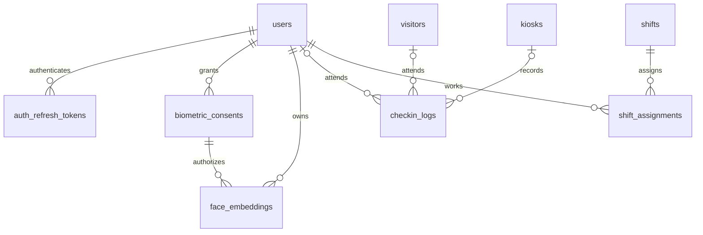

# Backend, AI, and data scope

Recorded: October 7, 2026. Status: design for MVP implementation, not existing functionality. Complete API contracts: [API ready to code](api/api-mvp-ready-to-code.md), [Backend OpenAPI](api/openapi-mvp.yaml), and [Internal AI OpenAPI](api/openapi-ai-internal.yaml).

Requirement sources: the user-provided Word document, “Library Entry/Exit Recording System — Implementation Guidance,” version 1.0, and [additional shift-scheduling requirements](yeu-cau-bo-sung.md). This summary keeps essential requirements in the repository so the team does not depend on a Word file on someone's machine.

## 1. Scope

- Backend: authentication, STUDENT/LIBRARIAN/ADMIN authorization, accounts, kiosks, FACE/QR/MANUAL entry/exit sessions, external guests, history, realtime occupancy, dynamic configuration, analytics, automatic checkout, and shifts.
- AI: enrollment with 3–5 images, 512-dimensional embeddings, 1:N cosine-distance matching, image quality, liveness, and model status.
- Team environment: Docker for PostgreSQL + pgvector, backend, and AI; Swagger is the App handover contract. Flutter/Figma implementation is outside this scope.
- Excludes shift swaps, leave, payroll, and employee attendance tracking.

## 2. Architecture and boundaries

App/kiosk → Spring Boot → FastAPI; the App does not call AI directly. Backend owns writes and transactions. AI only reads recognition candidates from PostgreSQL through a view and a separate DB account; it cannot read passwords/refresh tokens or write business tables.

Enrollment: backend validates consent, sends images to AI, receives embeddings, and persists them transactionally. FACE check-in: backend sends liveness evidence to AI; AI returns a candidate identity; backend rechecks account/consent/enrollment before changing sessions. Do not trust kiosk-supplied studentId or sample AI results.

Keep Java 21, Spring Boot 3.3.4, PostgreSQL 16, and Python 3.11 during foundation work; upgrades are separate verified changes. Spring Boot 3.3.x uses springdoc-openapi 2.6.x according to the [official compatibility matrix](https://springdoc.org/v2/#what-is-the-compatibility-matrix-of-springdoc-openapi-with-spring-boot). Lock Python dependencies and image versions/digests before handover.

Do not retain original images/uploaded videos after processing or log images, embeddings, QR, or tokens. Delete decoder temporary files even on errors. Retain consent/model metadata for traceability. All DB timestamps use TIMESTAMPTZ; calendar/time rules use Asia/Ho_Chi_Minh.

Liveness is a real requirement: face detection or a static image is not proof of life. The contract accepts a 1–3 second clip or frame sequence with a one-time challenge; verify the algorithm before using recognition to record entry/exit. Mock mode is for development only and is always marked.

## 3. Current DB audit

The repository currently contains:

- PostgreSQL JDBC configuration, enabled Flyway, and Hibernate ddl-auto=validate.
- An empty migration directory; entity/repository contain only .gitkeep.
- Compose using postgres:16-alpine without pgvector.
- No sample data, business schema, session constraints, or shift tables.

Conclusion: retain the configuration foundation, but the business DB is not implemented. There is no evidence of a working runtime schema. Do not inspect or modify other projects' databases on this machine.

The abbreviated Word design has four tables: users, face_embeddings, checkin_logs, system_config. Gaps:

| Gap | Proposed adjustment |
|---|---|
| users lacks login data and staff codes | Apply the additional requirement: rename student_code to code, add email; include password_hash, timestamps, and version |
| kiosk_id references a missing table | Add kiosks, credentials, status/heartbeat |
| No refresh tokens/revocation | Add auth_refresh_tokens; store hashes only |
| No consent/model metadata | Add biometric_consents and model_id/version in face_embeddings |
| Logs only have method and performed_by | Keep method as entry method; add exit method, kiosk, actor, and reason |
| Duplicate open sessions are possible | Partial unique indexes + per-person transaction locks |
| External guests have no student code | Add visitors; sessions reference exactly one user or visitor |
| No recognition-failure measurements | Add recognition_attempts without images/embeddings |
| No shift scheduling | Add shifts/shift_assignments with overlap prevention |
| Retry/rescan can turn entry into exit | Add access_requests for idempotency results and single-use qr_grants |

## 4. Proposed schema

All primary keys are UUIDs except system_config.key. Enums use VARCHAR + CHECK for easier migrations. Foreign keys specify deletion behavior; lock/soft-delete accounts/kiosks with history rather than cascading entry/exit history deletion.

| Table | Main fields and constraints |
|---|---|
| users | id, code UNIQUE NOT NULL, email UNIQUE NOT NULL, password_hash, full_name, role, status, must_change_password BOOLEAN, auth_version BIGINT default0, biometric_version BIGINT default0, created_at, updated_at, version; code is shared by STUDENT/LIBRARIAN/ADMIN; trim and normalize code to uppercase/email to lowercase |
| auth_refresh_tokens | id, user_id FK, token_hash UNIQUE, family_id, expires_at, revoked_at, replaced_by FK nullable; transactional rotation |
| kiosks | id, code UNIQUE, name, mode ENTRY/EXIT/AUTO, status ACTIVE/REVOKED, credential_hash nullable when revoked, credential_version BIGINT default0, last_seen_at, app_version, camera_status, version, created_at, updated_at; rotatable credentials |
| biometric_consents | id, user_id FK, policy_version, granted_at, revoked_at, version; at most one active consent per person |
| face_embeddings | id, user_id FK, consent_id FK, embedding vector(512), model_id, model_version, created_at; 3–5 embeddings for current enrollment |
| visitors | id, full_name, reference_code UNIQUE, created_by FK, created_at; manual access only, without login accounts |
| checkin_logs | id, user_id FK nullable, visitor_id FK nullable, method FACE/QR/MANUAL, kiosk_id FK nullable, performed_by FK nullable, manual_reason nullable, check_in_time, scheduled_checkout_at, entry_config_version, check_out_time nullable, check_out_method FACE/QR/MANUAL nullable, check_out_kiosk_id FK nullable, checked_out_by FK nullable, checkout_reason USER_ACTION/MANUAL/CLOSING_TIME/MAX_DURATION nullable, checkout_manual_reason nullable |
| access_requests | id, principal_type USER/KIOSK, principal_id UUID, idempotency_key UUID, request_method, request_path, request_digest HMAC-SHA256, status IN_PROGRESS/COMPLETED, response_status nullable, response_body JSONB nullable, created_at, processing_deadline, expires_at; UNIQUE(principal_type,principal_id,idempotency_key); no raw images/tokens |
| qr_grants | id, user_id FK, nonce_hash UNIQUE, expires_at, consumed_at nullable; no raw QR storage |
| system_config | key, value JSONB, updated_by FK nullable, updated_at, version; operational contains the full configuration object; face_policy contains notice/version; backend validates by schema |
| library_state | id SMALLINT PK CHECK(id=1), occupancy_revision BIGINT NOT NULL default0; lock this row for session/occupancy-configuration changes |
| face_challenges | id, kiosk_id FK, instructions JSONB, model_version, config_version, created_at, expires_at, consumed_at nullable; TTL 60 seconds, single use; no clips |
| recognition_attempts | id, access_request_id FK UNIQUE, kiosk_id FK, user_id FK nullable, outcome, model_version, cosine_distance nullable, liveness_score nullable, latency_ms, occurred_at; REAL kiosk recognition only, excluding enrollment/mock; idempotent retries do not increase counts |
| shifts | id, name, starts_at, ends_at, status ACTIVE/CANCELLED, cancellation_reason nullable, created_by FK, version, created_at, updated_at; 0 < ends_at-starts_at <=24 hours |
| shift_assignments | id, shift_id FK, staff_id FK users, starts_at, ends_at, status ACTIVE/CANCELLED, assigned_by FK, version, created_at, updated_at; copy shift times for DB overlap prevention |
| audit_events | id, actor_user_id FK nullable, actor_kiosk_id FK nullable, action, target_type, target_id, metadata JSONB, occurred_at; metadata excludes secrets/face data |

checkin_logs requires exactly one user_id or visitor_id; guests use MANUAL only. CHECK check_out_time >= check_in_time. Open sessions have NULL exit fields; automatic closures have NULL check_out_method/checked_out_by and checkout_reason CLOSING_TIME/MAX_DURATION. Manual logs record separate actors for each direction.

CHECK method=MANUAL requires non-NULL performed_by/manual_reason and NULL kiosk_id; FACE/QR requires non-NULL kiosk_id and NULL performed_by/manual_reason. Apply corresponding exit constraints without fabricated actors for automatic checkout. Composite FK face_embeddings(consent_id,user_id) references biometric_consents(id,user_id) (UNIQUE), preventing another user's consent from being attached. Assignments reference existing staff; validate ACTIVE LIBRARIAN under user locks because CHECK cannot read another table.

DB uniqueness must protect normalized code/email (CHECK code = upper(trim(code)), email = lower(trim(email))), not just API pre-insert checks. The role field determines roles, not code prefixes. Email serves account information/login; sending email and email-based password reset are outside the agreed scope.

Required initial indexes:

```sql
CREATE EXTENSION IF NOT EXISTS vector;
CREATE EXTENSION IF NOT EXISTS btree_gist;

CREATE UNIQUE INDEX uq_open_user_session ON checkin_logs(user_id)
WHERE user_id IS NOT NULL AND check_out_time IS NULL;
CREATE UNIQUE INDEX uq_open_visitor_session ON checkin_logs(visitor_id)
WHERE visitor_id IS NOT NULL AND check_out_time IS NULL;

ALTER TABLE shift_assignments ADD CONSTRAINT no_staff_overlap
EXCLUDE USING gist (
  staff_id WITH =,
  tstzrange(starts_at, ends_at, '[)') WITH &&
) WHERE (status = 'ACTIVE');
```

Add history (user_id, check_in_time DESC), occupancy (check_in_time) WHERE check_out_time IS NULL, recognition_attempts(occurred_at,outcome), shifts(starts_at), and QR/refresh expires_at indexes. Start pgvector with exact search; add HNSW only after measuring recall/latency on representative data. [pgvector](https://github.com/pgvector/pgvector) supports cosine distance; [PostgreSQL range constraints](https://www.postgresql.org/docs/16/rangetypes.html#RANGETYPES-CONSTRAINT) exclude overlapping time intervals.

AI reads ai_face_candidates with user_id, consent_id, biometric_version, embedding, model_id/model_version. The view includes only ACTIVE students, unrevoked consent for the current system_config.face_policy, and current enrollment. Grant AI SELECT on this view, not all users. Backend transactionally rechecks consentId/biometricVersion/modelVersion to handle concurrent account locking/face deletion/replacement during recognition.

Main relationships:



The diagram's nullable user/visitor FKs are governed by a table CHECK XOR, so each session has exactly one subject.

## 5. Initial implementation rules

The rules below fix defaults for the ready-to-code plan and remain distinct from the original Word requirements. The user may request changes before implementation; implementers do not need to invent additional APIs/DTOs/rules already defined in the contract.

- One library; do not add multi-branch tables.
- User requirement: add email and replace student_code with code for students/staff. Proposed defaults require code/email on accounts; code cannot contain @; login accepts identifier as code or email, without a separate username. No email verification/sending in the initial version.
- Access JWT: 15 minutes (audience library-app, purpose ACCESS, sub userId, sid familyId, authVersion). Refresh family: absolute 7 days from login; rotation does not extend expiry. Check ACTIVE, authVersion, and valid family on every protected operation. Password change/reset or role/status change increments authVersion and revokes all families. Admin create/reset sets mustChangePassword=true; dev seeds use false.
- QR: 30 seconds, separate QR_ACCESS purpose, single use. Reduces screenshot reuse without claiming to eliminate proxy check-in during validity.
- Idempotency-Key required for QR/FACE/MANUAL; scope (principal_type,principal_id,key), retention 24 hours. GET /access/requests/{idempotencyKey} recovers status/results without re-uploading. Same key with different method/path/payload returns 409; in progress returns 409 REQUEST_IN_PROGRESS. Cooldown 10 seconds for QR/FACE with different keys; explicit manual actions have no cooldown.
- AUTO kiosks select entry/exit from open-session state; support ENTRY/EXIT to fit gate placement. Staff explicitly choose CHECK_IN/CHECK_OUT for manual access.
- Reject check-in outside opening hours; always allow checkout. Default capacity: 250, near-capacity warning only; block entry only with capacity_enforcement enabled. When enabled, lock the max_capacity configuration row before counting/writing sessions to prevent concurrent over-capacity entry.
- Automatic checkout uses closing time or configured max_session_duration and explicit reasons; repeated runs do not duplicate events.
- Shifts are concrete dated intervals supporting overnight work; adjacent shifts are allowed with [start,end). No recurring schedule yet. Only ACTIVE LIBRARIAN users may be assigned; shift edits update all assignments atomically and reject new overlaps.
- Enrollment only for ACTIVE STUDENT users with consent; replace old embeddings atomically when the entire image set is valid. Delete embeddings together with consent revocation without deleting access history. Derive face_enrolled from current enrollment rather than maintaining an independent field that may drift.
- Librarian operation permissions are not tied to being on shift; scheduling does not automatically become a login condition.
- Calibrate cosine-distance/liveness thresholds for actual models/data; do not treat the existing 0.65 value as a quality-verified default.

### Fixed transaction and failure handling

- Claim access_requests through unique INSERT in a short transaction before inference; reservation: 60 seconds. HMAC body digest; no raw uploads/QR. AI only reads/extracts, so AI timeout has no external entry/exit side effects.
- Finalization lock order: access_requests → library_state(id=1) → user/visitor → session/QR/challenge. Recheck IN_PROGRESS/deadline, principal validity, biometric versions/status/config; write session, consume token, increment occupancy_revision, and store response atomically. Completed requests return the original response; never commit logs before idempotency results.
- Persist determined business-error responses as completed results for same-key replay; AI timeout 503 creates no session. After deadline, recovery workers lock the request and complete it with 503 REQUEST_ABORTED if not finalized. Old workers cannot commit after deadline; callers read status before deciding on a new intent. Cleanup expired rows only when completed; do not rerun requests with unknown outcomes automatically.
- recognition_attempts has unique access_request_id. Count each REAL inference actually sent to AI, including timeouts; invalid uploads rejected before inference do not count. MATCHED means identity match, not successful check-in (capacity/cooldown may reject the session). Enrollment/mock attempts do not enter kiosk-recognition statistics.
- Lock library_state for every session change, including manual/automatic checkout; capacity counts/revisions share this lock. Capacity/warning configuration changes lock state, update config/revision, and publish events so the App sees capacity changes too. Read snapshots in REPEATABLE READ transactions. Events carry increasing revisions and publish after commit; clients discard old revisions.
- Role/status/password/consent changes lock users; STUDENT users with open sessions cannot change roles but may be locked for manual librarian checkout. Do not require unlocking first. Protect the last Admin with a fixed advisory transaction lock and row locks, not a count-then-update check alone.
- Moving away from STUDENT after session closure revokes consent, deletes embeddings, and increments biometricVersion atomically; do not retain student biometrics for automatic reuse after future role changes. Derive profile faceEnrolled from current-policy consent/current embeddings; ACTIVE controls use, and locking alone does not delete enrollment.
- Enrollment consent grant/delete/re-enroll locks the user and increments biometric_version; deletion revokes consent and removes embeddings atomically. No AI gallery cache in MVP; candidate results carry biometricVersion/consentId for post-inference checks. Failed uploads preserve old enrollment.
- Assignment changes lock the shift then staff by ascending UUID; exclusion constraints are the final safeguard. Every assignment change increments assignment/shift versions. PATCH replaces staff atomically; DELETE soft-cancels only. CANCELLED shifts cannot be edited/reopened. ACTIVE shifts last ≤24 hours.
- Automatic checkout runs every 60 seconds. At check-in, calculate scheduled_checkout_at as the earlier of the containing opening slot's closing time and check-in+maxDuration; store entry_config_version. Ignore null maxDuration. After downtime, close at the stored cutoff, not restart time; lock/recheck open sessions and avoid duplicate events. Opening-hour/maxDuration changes apply to future entries without rewriting historical/open-session deadlines. Checkout is allowed on fully closed days. Overnight slots use their starting calendar day; scheduled_checkout_at > check_in_time.
- Operational defaults: Mon–Sun 08:00–22:00, maxCapacity=250, nearCapacityRatio=0.9, enforcement=false, maxDuration=null, cooldown=10; modelVersion/distance/gap/liveness=null, keeping FACE disabled until calibration. Seed face policy 1.0 in system_config; change policy version via migration, without an Admin policy-write API in MVP.
- AI serviceKey, JWT key, request-HMAC key, and bootstrap credentials are separate environment secrets. Missing AI read-only role/unready view makes readiness return 503; AI process health still returns 200.

## 6. App-team handover contract

- Public APIs: /api/v1/*, camelCase JSON, UUID strings, timezone-aware ISO-8601; lists use page/size/sort with maximum size 100.
- Swagger: /swagger-ui/index.html; OpenAPI: /v3/api-docs and /v3/api-docs.yaml; include JWT Authorize, tags, success/error examples, multipart images/clips, permitted roles, and retry rules.
- Shared errors: code, message, fieldErrors, traceId, timestamp; distinguish 400/401/403/404/409/413/422/503.
- Access response: requestId, sessionId, action CHECK_IN/CHECK_OUT, subject {id,kind,fullName,code}, method, occurredAt, occupancy {count,maxCapacity,nearCapacity,capacityEnforcement,revision,asOf}, simulated=false. Guest subject.code is referenceCode. Email appears only in authorized profile/account APIs, never occupancy events.
- Kiosks are separate service principals, not student accounts or a fourth staff role. Backend derives kioskId from authenticated credentials rather than trusting body-supplied kioskId.
- Configure a Flutter Web CORS allowlist; API hosts on physical devices may differ from localhost. Dev instructions explain Android emulator 10.0.2.2 and physical phones using the host machine's IP.
- Realtime STOMP /ws, topic /topic/occupancy; JWT authenticates CONNECT, only LIBRARIAN/ADMIN may subscribe. Events include eventId, occurredAt, revision, count, maxCapacity, nearCapacity, change {sessionId,action}; CONFIG_CHANGED omits sessionId. Fetch REST snapshots after reconnect and discard old revisions. WebSocket delivery during disconnection is not guaranteed.
- OpenAPI does not fully describe STOMP automatically; use Swagger description and x-realtime to document URL, auth, destinations, payload, and reconnect behavior. App developers should not need to read implementation code.

## 7. Team Docker environment

Dedicated compose.dev.yml runs only postgres, backend, and ai-service; the team develops the App separately. CPU is the default; mock AI uses an explicit flag and simulated=true responses, and cannot create real FACE logs. Real AI requires model images/manifests with checksums/model_version and volume-based caching; restarts do not redownload models automatically. Mock readiness does not establish real-model readiness.

Backend health depends on DB/schema but not AI, so QR survives AI failures. AI separates liveness/readiness; backend returns 503 with QR guidance when AI is unavailable. Unloaded/unverified models fail readiness.

PostgreSQL volumes are scoped to Compose projects; dev seeding is repeatable and enabled only by the dev profile. Remove fixed container_name. Publish backend for the App; expose DB/AI only on localhost or internal networks. Resolve port conflicts through environment variables. Never run down -v on team data in use.

Verify amd64/arm64 through actual builds and smoke tests per architecture before declaring support. If AI dependencies do not run on arm64 yet, document the limitation and provide mock mode so the App team can continue.
